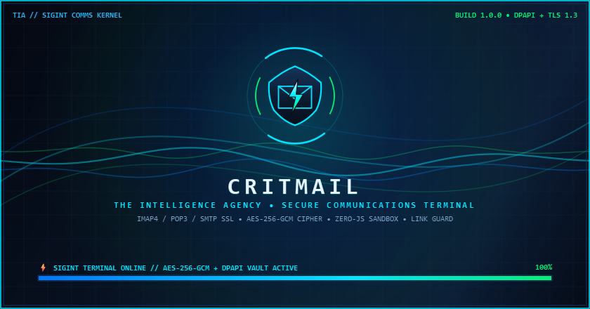
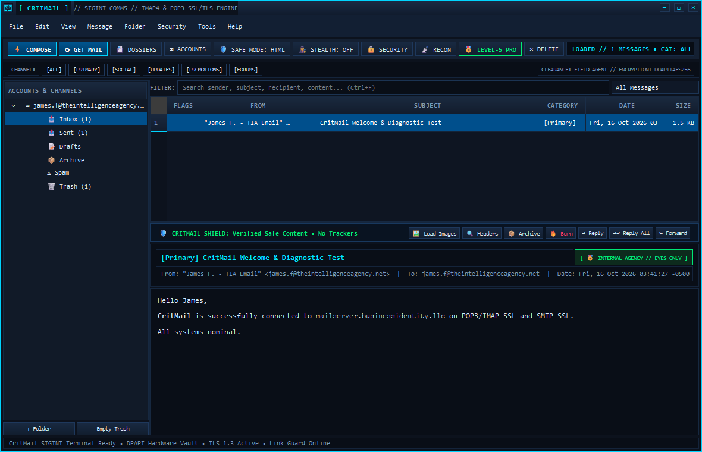

# 
 CritMail // SIGINT Communications Terminal

  <strong>Ultra-Fast • Hack-Proof • Winamp 3 Monospace & SIGINT Security Email Client for Windows, macOS & Linux</strong> 
  <em>Zero Rounded Corners. AES-256-GCM Classified Cipher. Hardware Vault. Zero-JS Sandbox.</em>

  
  
  

  
  

  
  
  
  

  

---

## ⚡ About CritMail

**CritMail** is a standalone, security-hardened desktop email client engineered with a razor-sharp **Winamp 3 Electric Blue** + **SIGINT Intelligence Agency** aesthetic (`0px` corners, `1px` high-contrast borders, pure monospace typography, and zero web-engine bloat).

- **Animated SIGINT Boot Splash:** Launches with a 60 FPS hardware-accelerated telemetry wave & orbital radar splash screen.
- **Zero-JavaScript HTML Sandbox:** Neutralizes `<script>`, `<iframe>`, `<object>`, event handlers, and invisible 1x1 tracking pixels before any message is rendered.
- **AES-256-GCM Classified Cipher ("EYES ONLY"):** Encrypt outbound bodies with PBKDF2-HMAC-SHA256 (200,000 iterations) + AES-256-GCM and decrypt in volatile RAM without touching disk.
- **Stealth Redaction Mode (`Ctrl+Shift+X`):** Live-masks email addresses, IPv4 addresses, and phone numbers on screen (`[██REDACTED██]`) for shoulder-surfing and stream/screenshare protection.
- **Cryptographic Burn / Shredder (`Shift+Del`):** Overwrites cached attachment bytes on disk with random entropy and scrubs SQLite fields before purging.

  

---

## 🚀 Quick Download & Setup

> **No Python or developer tools required.** CritMail ships as self-contained native builds for **Windows (`CritMail-v1.0.0-win64.exe`)**, **macOS (`CritMail-v1.0.0-macOS.dmg`)**, and **Linux (`CritMail-v1.0.0-linux-x64.tar.gz`)**.

1. **[Download CritMail for Windows, macOS, or Linux from the Official Releases Page](https://github.com/critmaths/crit-mail-client-releases/releases/latest)**
2. Launch `CritMail` (`CritMail.exe` on Windows, `CritMail.app` on macOS, or `./CritMail` on Linux).
3. Click **`[ ⚙ Accounts ]`** in the bottom-left sidebar (or `File -> Account Settings`), enter your mailbox credentials (encrypted locally via OS DPAPI / AES-256-GCM vault), and click **`⚡ Test Connection`**.
4. Press **`F5`** or click **`[ ⟳ Sync Mail ]`** to synchronize your inbox!

---

## 🛡️ Key Security & Intelligence Features

### 🔐 Classified Cryptography & Active Defense
- **AES-256-GCM Body Cipher:** One-click encryption in the Compose window (`🔐 Encrypt Body (TIA Cipher)`) and instant in-memory decryption (`🔓 Decrypt Cipher`) in the reader pane.
- **Anti-Phishing Link Guard:** Intercepts every clicked URL to inspect domain mismatches, insecure HTTP, raw IP links, and IDN homograph (`xn--`) punycode attacks before opening a browser.
- **Dynamic Classification Stamps:** Automatically badges messages as `[ 🔐 TOP SECRET // AES-256-GCM CIPHER ]`, `[ 🎖 INTERNAL AGENCY // EYES ONLY ]`, `[ ⚠ QUARANTINE // HOSTILE SIGNAL ]`, or `[ 📡 EXTERNAL INTERCEPT // CLEARED ]`.
- **1-Click RFC 8058 Auto-Unsubscribe:** Detects `List-Unsubscribe` headers (even across folded multi-line headers) and executes 1-click HTTPS POST or `mailto:` unsubscription.

### 📇 Agent Dossiers, Rules & Diagnostics
- **Agent Dossier Sheets (`Ctrl+B`):** Track up to 3 labeled phone numbers, employer, university, notable allegiances, relationship status, social/web links, and confidential notes.
- **Automated Mail Forwarding, Vacation Auto-Responder & Folder Routing:** Full rule engine for sender/domain/keyword blacklisting, custom folder routing, and loop-safe auto-replies.
- **Live Comms & DNS Recon Terminal (`📡 RECON`):** Built-in diagnostic console that verifies `MX`, `SPF`, and `DMARC` DNS records alongside live `IMAP (993)`, `POP3 (995)`, and `SMTP (465)` TLS handshakes.

---

## 🎖️ Clearance Tiers (Freemium & Level-5 Pro)

| Capability | Field Agent (Free) | Level-5 Operative (Pro) |
| :--- | :---: | :---: |
| **IMAP4 / POP3 / SMTP SSL Client** | ✅ Included | ✅ Unlimited Accounts |
| **Zero-JS HTML Sandbox & Tracker Blocker** | ✅ Included | ✅ Included |
| **Anti-Phishing Link Guard & 1-Click Unsubscribe** | ✅ Included | ✅ Included |
| **Stealth Redaction Mode & Cryptographic Burn** | ✅ Included | ✅ Included |
| **AES-256-GCM Classified Cipher Mode** | ✅ Included | ✅ Included + Self-Destruct Links |
| **Official `@theintelligenceagency.net` Callsign** | — | ✅ **Included (`agent@theintelligenceagency.net`)** |
| **Burner / Dead-Drop Alias Generator** | — | ✅ **Unlimited Disposable Aliases** |
| **Attachment EXIF / Metadata Scrubber** | — | ✅ **Automatic Pre-Send Scrubbing** |
| **Duress / Panic Vault PIN** | — | ✅ **Decoy Safe-Room Inbox** |

---

## 💻 System Requirements

- **Operating System:** Windows 10/11 (64-bit), macOS 12+ (Apple Silicon & Intel), or Linux (x86_64)
- **RAM:** ~65 MB typical footprint
- **Storage:** Local SQLite WAL database + Windows DPAPI / AES-256-GCM hardware vault (`~/.critmail`)

---

## 🤝 Support, Community & Donations

If you enjoy **CritMail** and want to support continued development of **Critical Softworks** & **The Intelligence Agency** security tools:

- 🌐 **Official Website & Agent Portal:** [theintelligenceagency.net](https://theintelligenceagency.net)
- 🐛 **Issue Tracker & Bug Reports:** [Open a GitHub Issue](https://github.com/critmaths/crit-mail-client-releases/issues)
- 💖 **Sponsor on GitHub:** [github.com/sponsors/critmaths](https://github.com/sponsors/critmaths)
- 🧡 **Support the Project on Patreon:** [patreon.com/omav](https://patreon.com/omav)

  
  

  <em>© 2026 CritMail // The Intelligence Agency • Critical Softworks. All rights reserved.</em>

